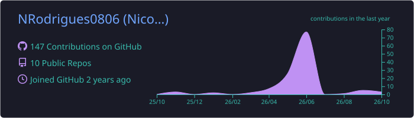

## Olá! Sou o Nicolas Rodrigues, Engenheiro de Processos & Automação!

- Atualmente atuo na Engenharia de Processos e Automação no Itaú Unibanco (Seguros PJ), com foco em mapeamento de ponta a ponta (BPMN / Lean Six Sigma), eliminação de gargalos operacionais e desenvolvimento de soluções com foco em RPA e agentes de I.A.
- Foco técnico em Automação e Processos com Power Platform (Power Automate, Power Apps), Python, SQL, observabilidade de rotinas automatizadas e estudos contínuos em Copilot Studio, além de sólida bagagem em Engenharia de Dados (ETL) e Engenharia de Software.
- 🎓 Cursando Bacharelado em Sistemas de Informação pela Universidade Santa Cecília (Unisanta) - Formação em 12/2027.
- Compartilhando por aqui meus projetos práticos de automação, dados e arquitetura de software, focados em transformar fluxos complexos em eficiência real.

  
  
  
  
  
  

 

 
   
  
   

## 📊 GitHub Stats

